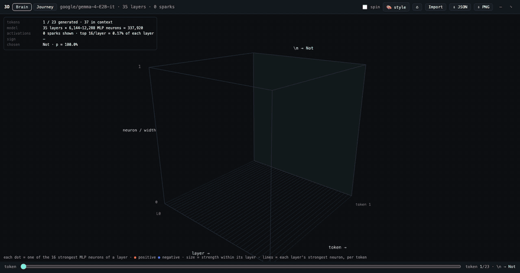
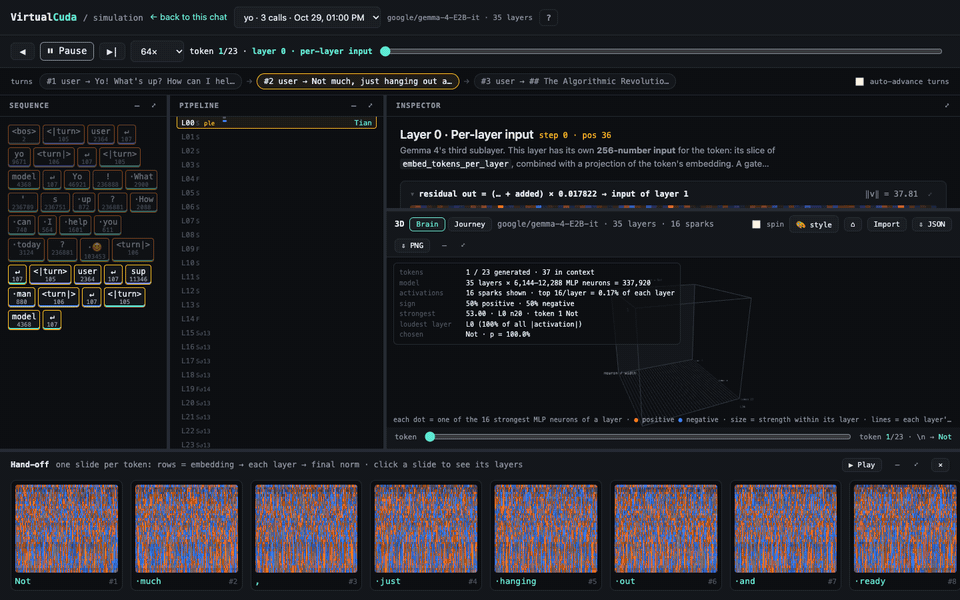
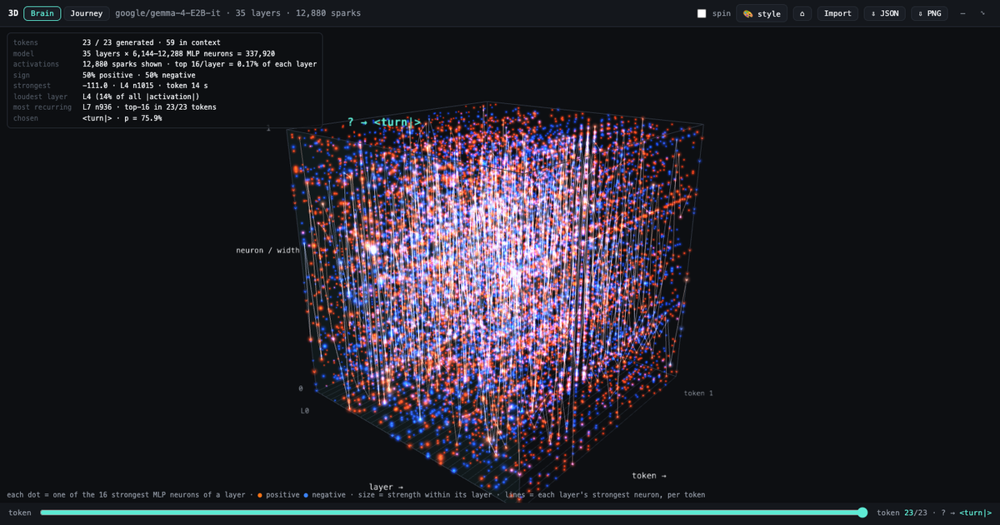
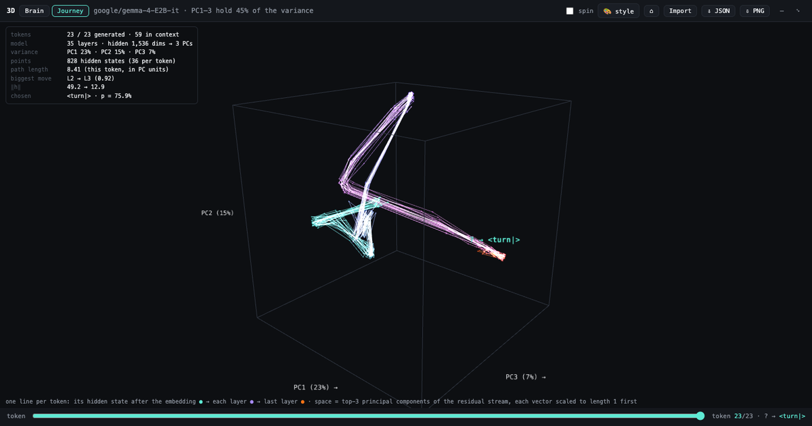
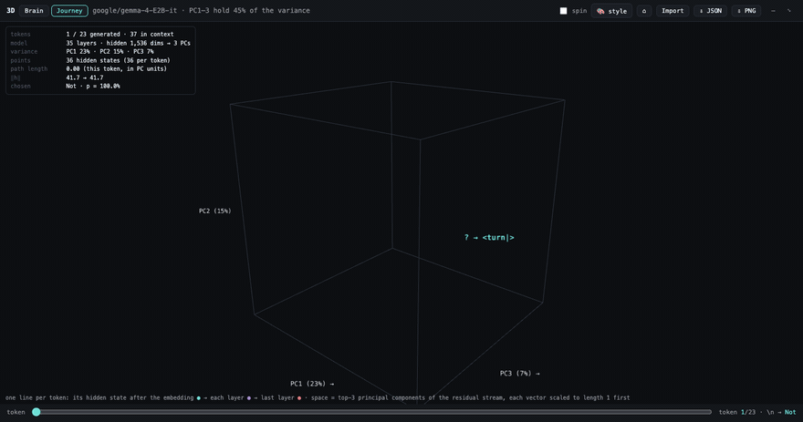
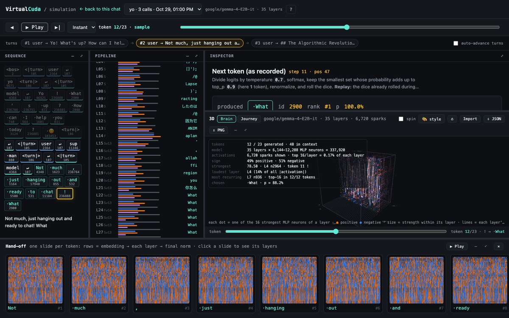

# VirtualCuda

> **Status: experimentation phase.** Right now we're not building the predictor yet. We're deep-diving into real LLMs layer by layer to **see, analyse and feel** what every layer actually does to a token, before trying to predict it.

<p align="center">
  
</p>

## The Idea

> "We do not need big hardware for LLM if we can just generate layer outputs by predicting it."

> "What CUDA does can be just a higher dimensional math function, and that's why VirtualCuda."

Each layer of an LLM is a math function: a high-dimensional vector goes in, a vector comes out. CUDA and big GPUs are just a way to compute those functions exactly, fast.

VirtualCuda explores whether those layer outputs can be **predicted** instead of computed exactly, so LLMs can run without big hardware. To predict a function, you first have to know it intimately. That's what this phase is for.

## What's here today

A local, OpenAI-compatible chat server plus a **step-by-step simulator** that replays any chat turn through the real model, capturing every number from the actual forward pass. Nothing is illustrative: token ids, embeddings, each layer's residual stream, attention weights, MLP neurons, logits and the sampling decision are all real.

### The simulator (`/sim`)



- **Sequence**: every token of the context, including chat-template specials and image/audio slots.
- **Pipeline**: each layer's residual / attention / MLP contribution, with a logit lens per layer.
- **Inspector**: what the current stage does, with the real tensors (attention heads, neuron histograms, top candidates…).
- **Hand-off**: one slide per token showing the hidden state flowing embedding → layers → final norm.
- **Turns**: multi-call chats (including tool calls) replay one call at a time, teacher-forced, so you see exactly the pass that produced the reply.

### 3D views: Brain & Journey

| Brain | Journey |
|---|---|
|  |  |
| x = layer, y = neuron ÷ MLP width, z = token. The 16 strongest MLP neurons of every layer, orange positive / blue negative, sized by strength. Lines trace each layer's strongest neuron per token. | Each token's hidden state, embedding → every layer, drawn in the top-3 PCA space of the residual stream. Tokens gather in the middle layers and split toward their outputs. |

<p align="center">
  
</p>

- **Insights overlay**: tokens and context length, total MLP neurons, sparks shown, sign split, strongest activation, loudest layer, most recurring neuron, path length, biggest per-layer move, ‖h‖.
- **🎨 Style**: palettes, custom colors, color by sign / layer / token, and past-token trails (fade, persist all, last N, current only).
- **Export / import**: a small JSON, or a PNG with that JSON embedded. A shared image alone is enough to reopen the exact plot, no model needed.



## Run it

```bash
python3 -m venv .venv && .venv/bin/pip install -r requirements.txt
.venv/bin/python server.py --model google/gemma-4-E2B-it
```

Then open http://localhost:8700 to chat and http://localhost:8700/sim to dive in. Chats are recorded locally in `data/` (git-ignored).

The current experiments target **Gemma 4 E2B / E4B** on a 24 GB Mac mini (models up to ~8B). Which architectures load is decided by an exactness self-test: see [docs/supported-models.md](docs/supported-models.md).
